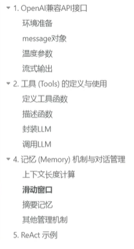
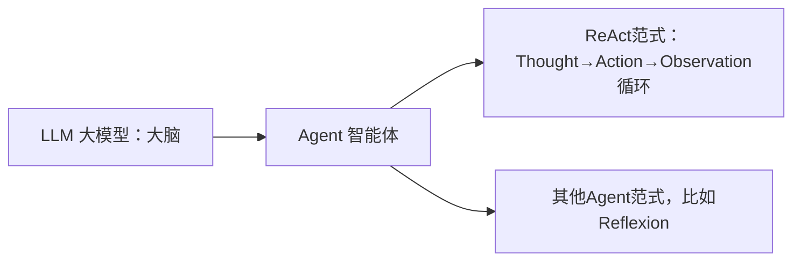

LLM（大语言模型，大脑）
    ↓ 作为核心
Agent（智能体：大脑 + 工具 + 循环流程）
    ↓ Agent可以选不同工作策略，ReAct是其中一种
ReAct（Reason+Act：思考→行动→观察，一套循环思路）

======= Memory 记忆机制与对话管理 =======
> 解决LLM上下文窗口有限的问题

 短期记忆（本轮对话上下文）
- 滑动窗口：只保留最近N轮对话，超了就丢掉最早的
- 摘要记忆：把很早的对话压缩成一段摘要，节省token

长期记忆（跨会话，RAG相关）
- 向量数据库记忆：文本向量化存入向量库，提问时检索召回（就是RAG最常用）
- 知识图谱记忆：保存实体、关系，适合需要推理关联信息的Agent

- **API**：接口（是一个服务地址，比如 `https://api.deepseek.com`，原始通信规则）
- **SDK**：封装好的代码库，帮你方便调用 API，SDK = Software Development Kit，软件开发工具包
`import openai`
这个 openai Python 库，**就是 OpenAI 官方提供的 SDK**。
它底层帮你处理 HTTP 请求、拼装 json、解析返回结果，你只需要写 `client.chat.completions.create(...)`，不用自己手写网络请求。

👉 重点一句话：
**ReAct 是【思考方案】；框架是【承载各种思考方案的代码平台】**
框架≠ReAct，框架只是帮你方便实现 ReAct（以及别的 Agent 逻辑），不用自己手写 while 循环、拼接消息、处理 tool 返回。框架是一套代码基础设施、脚手架它里面可以内置支持 ReAct 这种思考模式，也支持别的思考模式。