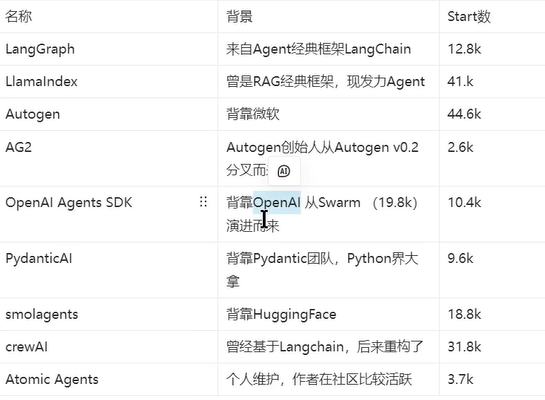
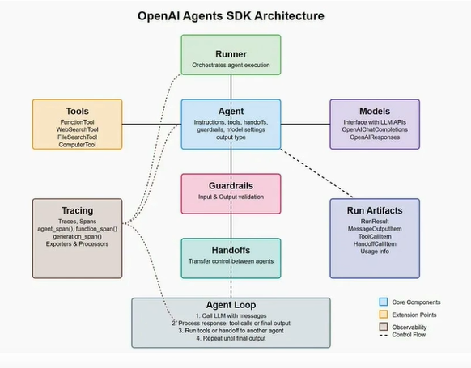

常见的AGENT开发框架

## 情况 1：最常见！多 Agent，但是只用同一个 LLM

比如 CrewAI / AutoGen 经典例子：

- Agent A：研究员，负责查资料
- Agent B：写稿员，负责整理文字
- Agent C：评审员，负责挑错
三个 Agent，**全部都连同一个 DeepSeek（同一个 LLM）**
只是它们的系统提示词不一样、任务分工不一样，互相发消息对话协作。
✅ 这里：多 Agent，单 LLM

> 
> 类比：三个不同岗位的人，脑子智商水平一样（同一个大脑），只是各司其职、互相沟通。

## 情况 2：多 Agent + 不同 LLM（可选，不是必须）

你也可以这么搭配：

- 研究员 Agent：用 DeepSeek
- 代码 Agent：用 擅长写代码的模型
- 总结 Agent：用千问
✅ 这是多 Agent + 多个 LLM，属于**可选搭配方案**，不是多 Agent 的定义。

## 情况 3：反过来：一个 LLM，能不能是单 Agent？

当然可以！就是你之前写的工具调用程序：
一个 Agent，一个 LLM，自己 ReAct 循环调用工具，没有别的智能体和它对话。

OpenAI Agents SDK Architecture

整个图是一套**已经封装好的流水线**：
`Runner（调度）` 驱动 `Agent`，Agent 一边连 `Models（大模型API）`、一边调用 `Tools`；
中间还有 `Guardrails（校验护栏）`、`Handoffs（Agent之间交接任务）`，底层跑的就是那个 **Agent Loop 循环（就是 ReAct 循环）**。

什么也没改我就是测试一下怎么用